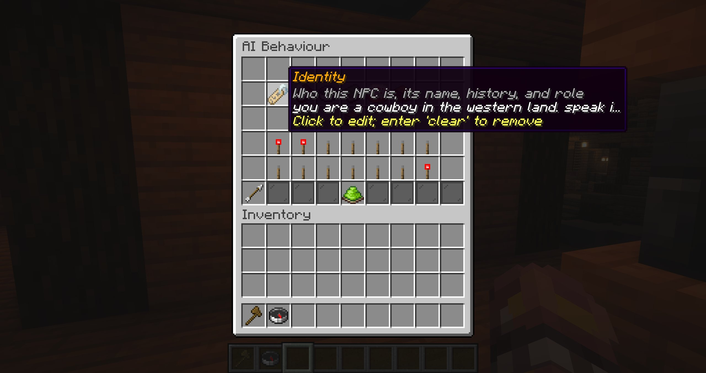
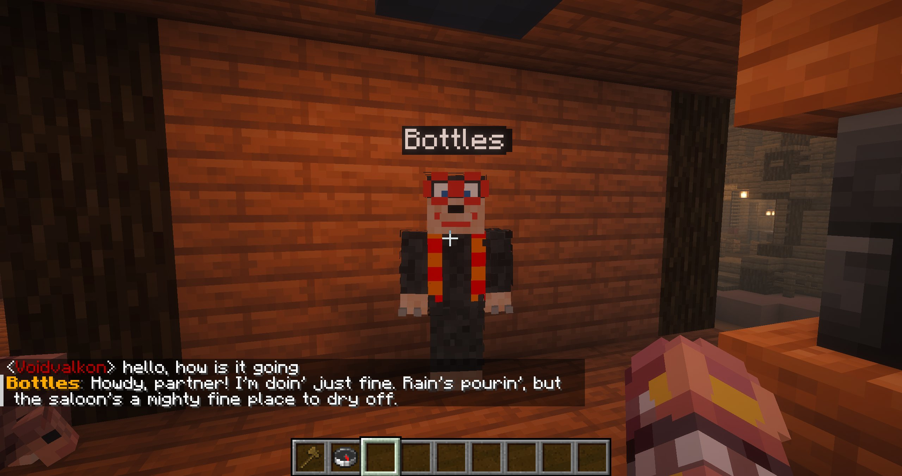

# AI behaviour

AI behaviour is an optional OpenRouter-powered layer. The model receives bounded context and proposes gameplay actions through native function calls. Blockfolk validates those calls against the preset's enabled actions and the request's target aliases before applying them. Requests run asynchronously, so deterministic behaviour is not delayed.

## Configure OpenRouter

Set at least the API key and model in `plugins/Blockfolk/config.yml`, then restart the server:

```yaml
openrouter:
  endpoint: "https://openrouter.ai/api/v1/chat/completions"
  api-key: "your-api-key"
  model: "deepseek/deepseek-v4-flash-0731"
  timeout-seconds: 17
  max-tokens: 1600
  reasoning-effort: "low"
```

Keep the endpoint on HTTPS. The AI menu reports whether OpenRouter is ready.
Choose a model and provider that support native function calling for gameplay actions.

Conversation history is controlled separately under `ai-control`:

```yaml
ai-control:
  conversation-history-limit: 20
```

The limit counts stored conversation lines, not complete back-and-forth turns. Set it to `0` to disable runtime conversation history.

## Describe the NPC

Open an NPC preset and choose **AI Behaviour**. Configure one or more context sections:

| Section                 | What to write                                           |
| ----------------------- | ------------------------------------------------------- |
| Identity                | Who the NPC is, including its name, history, and role.  |
| Personality & Behaviour | How it speaks, reacts, and treats others.               |
| Goal / Role             | What it should accomplish or prioritize.                |
| Knowledge / Information | Lore, facts, rules, and local knowledge it may use.     |
| Likes & Dislikes        | Things it enjoys, avoids, values, or strongly dislikes. |

At least one section is required before AI behaviour can be activated.

## Choose triggers

Players can use `/bf config ai mute-me on` to keep their nearby chat from triggering NPC AI responses, then `/bf config ai mute-me off` to allow responses again. Players start unmuted.

Add **AI Trigger** to any standard event, custom event, waypoint, or question branch. A dialog asks for an optional prompt
to guide the AI for that specific trigger. Leave it empty to use the surrounding event as the request reason without
extra guidance.

Enable **Respond to Nearby Chat** for direct player conversation within eight blocks. One NPC answers each chat message: the NPC named in it, otherwise the closest one. If that NPC is busy, the turn waits for it rather than moving to another speaker. Other NPCs nearby with **Respond to Nearby NPCs** hear the reply and can chime in, which starts a conversation between NPCs (see below).

### Conversations between NPCs

Enable **Respond to Nearby NPCs** to let an NPC answer what other NPCs say within 12 blocks. AI speech and **Send Dialog** lines count, so a scripted line can start an AI conversation. **Show Holo Dialog** lines are ignored, so repeating flavour text above an NPC never starts or interrupts a conversation. An NPC's reply to a player counts too: listeners also see what the player said, so they can chime in on it or answer the player.

For example, give a cowboy an **On Nearby NPC** row with an AI Trigger ("Confront bandits; greet everyone else") and enable **Respond to Nearby NPCs** on the bandit. When the bandit walks up, the cowboy speaks first and the bandit answers. Enable the switch on both NPCs for a back-and-forth. Several NPCs in range respond together as a group, in one coordinated request. The NPC named in the latest line is the intended responder, otherwise the closest one. NPCs in a conversation turn their heads to whoever is speaking, and back to the nearest player about 10 seconds after the last line. NPCs with **Look at Player** off keep their facing. Responding NPCs can use any of their enabled capabilities, so two NPCs can talk about a lever and then pull it with **Interact**.

Conversations between NPCs are limited so they cannot loop:

- **Reply cap:** each conversation allows `max-replies` response rounds, 6 by default. The model is told how many remain and closes the conversation on the last one.
- **Time limit:** a conversation ends after `max-duration-seconds`, or after 30 seconds without a new line.
- **Cooldown:** when a conversation ends, its NPCs wait `cooldown-seconds` before talking to each other again. A reply to a player is exempt, so NPCs can chime in on every chat message.
- **Player nearby:** NPCs only talk to each other while a player is within `player-range` blocks.
- **Player interrupts:** when a player chats with an NPC, its NPC conversation ends and the NPC answers the player. Its reply can start a new conversation with a fresh reply cap.

```yaml
ai-control:
  npc-conversations:
    max-replies: 6
    max-duration-seconds: 120
    cooldown-seconds: 120
    reply-delay-seconds: 2
    hearing-range: 12
    player-range: 32
```

Set `max-replies` to `0` to turn NPC replies off server-wide. Each NPC in the conversation remembers its lines. The same NPCs share their conversation history the next time they talk, and memory reviews can save facts from it like a player conversation. Players within 16 blocks see the memory notice.

### NPC names and aliases

Requests use readable Response IDs such as `npc_mr_mario` to route function calls to the right NPC. If multiple participating NPCs have the same normalized name, their IDs become `npc_mr_mario_01`, `npc_mr_mario_02`, and so on for that request. The display name appears beside the ID in both the system context and participant heading. The player's exact chat message is included, so a message such as “Mr. Mario, how is your day?” selects **Mr. Mario** as the intended speaker.

If a group response omits the intended speaker, Blockfolk asks that NPC separately and keeps valid actions from the other NPCs. A silent intended speaker can use **Do Nothing**.

## Restrict capabilities

Every capability is toggled per preset. **Start/Stop Combat**, **Follow/Unfollow**, **Start/Pause Route**, and **Enter/Exit Vehicle** each use one switch that enables both actions. Other controls include speech, animations, fleeing, interacting, moving, mining, and returning home. **Do Nothing** is always available.

**Enter/Exit Vehicle** lets an NPC walk to a listed minecart or boat and get in, or get out of the one it is riding. The AI always sees whether the NPC is riding and which vehicles are nearby, even without this capability. Any walking action (Move To, Follow, Flee, Return Home, Start Route) also gets a riding NPC out first, so the AI can leave a vehicle by simply walking away. **Interact** keeps the NPC aboard: it uses switches or containers within reach and waits for farther targets to come within reach as the vehicle moves. Automatic boarding is a separate property, **Board Vehicles** (see [Customization](customization.md#riding-minecarts-and-boats)).

**Remember Location** lets an NPC save its current position under a name in the global Locations selection. The model supplies only the label; Blockfolk records the NPC's position when the action runs. Saved AI locations use a diamond icon and nearby players receive a chat notice. A name already in use cannot be overwritten.

For an **On Damage Taken** AI Trigger that should retaliate, enable **Start/Stop Combat** in AI Behaviour and set the NPC's maximum health above zero in **Fighting & Survival**. The prompt can ask the NPC to attack its attacker, but cannot enable a disabled capability. When the attacker is known, the request exposes it as `triggering_entity`; a valid combat target must still be alive and attackable when the model responds. For guaranteed retaliation, put the regular **Start Combat** action on the damage event and use AI Trigger for optional speech or other reactions.

The model cannot issue commands, executable code, arbitrary coordinates, or unlisted entity identifiers. A disabled, malformed, or unadvertised function call is rejected.

## Inventory and world interaction

Enable **Temporary Inventory** when the AI should see and manipulate the items carried by each instance. This also enables container transfers and direct collection of mined drops. If mined drops do not fit, the block remains untouched. Without temporary inventory, mined blocks drop items naturally.

Nearby containers include their custom names in the NPC's context when set. With container interaction enabled, players can refer to a named container such as “Food Supplies”; the NPC matches that name to the listed container target for taking or storing items.

## Conversation and memory

Conversation can be:

- **Private** — each player has a separate conversation with that NPC instance;
- **Shared** — all players contribute to one conversation on that instance.

When every NPC that would answer a player's chat uses **Private** conversation and no other player is within 16 blocks of the player or those NPCs, the player's chat message is shown only to that player instead of the whole server. The NPC's reply is already limited to players within 16 blocks. If anyone could overhear, or if one of the answering NPCs uses **Shared** conversation, the message is sent to chat as usual. The server console still logs it.

Long-term memory is separately optional. It stores up to 45 facts on the preset, shared by its instances and retained across restarts. The AI reviews up to 20 recent conversation lines after 20 seconds without a new player chat message; each follow-up message resets this timer. It saves only key facts about people and agreements, such as how someone treated the NPC, deals and promises, agreed meetings, and important news. It does not store reminders of what the NPC is currently doing; follow-through happens during its action turns. Most conversations save nothing; at most three facts are saved. Facts are classified as Personal (red, private knowledge and deals), Regional (green, local news shared with AI NPCs that have memory enabled within 50 blocks of where it was learned), or Temporal (blue, changing facts that expire after 24 hours). NPCs with memory disabled do not receive regional facts. At capacity, saving a new fact replaces the oldest Temporal fact if one exists; otherwise, it replaces the oldest fact. Existing facts without a category become Personal. Players see "NPC is telling the others..." when a Regional fact is saved and "NPC remembered this..." for Personal or Temporal facts. For conversations between NPCs, players within 16 blocks of the NPC see these notices. Administrators can add, edit, reclassify with shift-left-click, delete, or clear facts in the memory menu. Newly added facts start as Personal; manually reclassified Regional facts are centered on the administrator’s position.

The number of recent conversation lines supplied to the model is set globally with `ai-control.conversation-history-limit`. Its default is `20`; when the limit is exceeded, the oldest lines are discarded first.

Opening a preset's admin editor resets runtime AI state and queued interactions for every spawned copy of that preset. Durable long-term facts remain until edited or cleared.

## Request lifecycle

While a request is in flight, a hologram cycles through `Thinking.`, `Thinking..`, and `Thinking...`. The AI can use up to three model rounds in a gameplay turn, receiving tool results and updated NPC state between rounds. Each NPC is limited to eight actions and one spoken message per turn. Requests have a per-NPC cooldown in addition to trigger throttling. Up to eight waiting chat turns per player and eight waiting AI events per NPC are kept in arrival order. Queued chat turns expire after 30 seconds; queued events expire after 15 seconds. Unusable action calls are logged and retried once before the turn is abandoned. Long-term memory review still uses JSON output.

For the exact prompt structure, perception limits, target aliases, and memory rules, see [AI request context](/reference/ai-request-context).

<div class="screenshot-grid">
  
  
</div>
