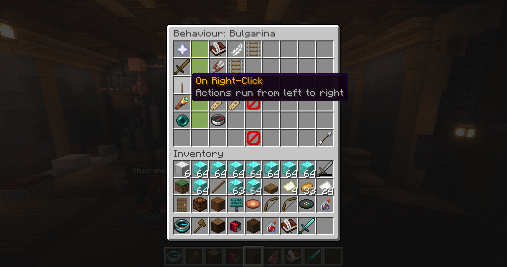
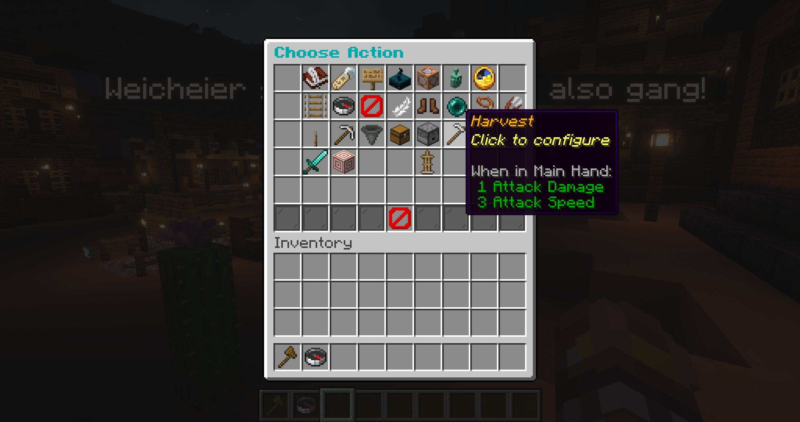

# Behaviour routines

Behaviour routines connect an event to an ordered row of up to seven actions. Actions run from left to right.

## Events

The standard editor provides these triggers:

- lifecycle: **On Spawn**, **On Idle**, and **On Death**;
- players: **On Left-Click**, **On Right-Click**, **On Player Approach**, and **On Player Leaves**;
- combat and health: **On Damage Taken**, **On Nearby Aggression**, **On Low Health**, **On Heal**, **On Combat Entered**, and **On Combat Exited**;
- world: **On Entity Nearby**, **On Nearby NPC**, **On Drop Item**, and **On Receive Item**;
- time: **At Sunrise**, **At Noon**, and **At Sunset**.

Nearby chat is configured from the AI menu rather than shown as a deterministic behaviour row.

**On Damage Taken** runs when an NPC takes damage from an entity or the environment. When an attacker is known, actions receive that entity as their trigger, and AI Trigger includes its name and the damage amount in the event context. Saved **On NPC Attacked** actions are moved before existing damage actions when the preset loads. A row holds seven actions; if the combined routines exceed that limit, the server logs a warning and saves a copy of the original preset with a `.pre-damage-merge.bak` suffix.

**On Nearby Aggression** runs when another living entity, including an animal, player, or NPC, takes damage or is hit by an entity within eight blocks. The victim is the action trigger; AI Trigger receives the victim, damage amount, and attacker when known. Cancelled damage events do not trigger it.

**On Combat Exited** tells AI Trigger why the fight ended: the NPC defeated its opponent, the opponent died to someone else, got away, or could not be reached, the NPC escaped while fleeing, combat was stopped by an action or new fight options, or the NPC died. When the opponent dies and another recent attacker is in reach, the NPC turns to it without leaving combat.

**On Receive Item** and **On Drop Item** tell AI Trigger which items moved, how many, and how: picked up from the ground, put in or taken out by a player, mined, harvested or planted, taken from or stored in a container or a player's inventory, dropped, or emptied into nearby containers.

**On Entity Nearby** ignores Blockfolk NPCs. Use **On Nearby NPC** for them: it runs when another Blockfolk NPC comes within eight blocks, with that NPC as the action trigger. It only runs while a player is within `ai-control.npc-conversations.player-range` (32 blocks by default); NPCs that were already standing together fire it once a player arrives. After it fires for two NPCs, neither fires it for the other again until `ai-control.npc-conversations.cooldown-seconds` has passed, so two NPCs meeting at the same moment do not both react. Combined with AI Trigger and **Respond to Nearby NPCs**, it starts [conversations between NPCs](./ai-behaviour.md#conversations-between-npcs).

## Actions

| Group | Available actions |
| --- | --- |
| Dialogue & scripting | Send Dialog, Show Holo Dialog, Ask Question, Emit Custom Event, Console Command, AI Trigger, Wait |
| Movement | Set Route, Start/Stop Navigation, Set Walk Speed, Move To, Teleport To, Follow, Unfollow |
| World & inventory | Interact, Mine Blocks, Take Item, Show Inventory, Drop Inventory, Harvest, Open Shop |
| Combat | Start Combat, Change Fight Options |
| Animation | Sleeping, Swimming, Fall Flying, Standing, Sneaking, Sitting, Wave, Jump |

**Move To** pauses the rest of its action sequence until the NPC arrives. If it cannot arrive, the sequence continues after 30 seconds.

**Open Shop** opens the chosen shared [shop](./shop.md) in the vanilla trading screen for the triggering player. It does nothing on triggers without a player.

**Console Command** uses a command block icon. Selecting it prompts for a command without the leading slash, which runs as the server when the action triggers.

**Harvest** collects mature crops and plants seeds from the NPC's temporary inventory on nearby empty farmland. It also plants nether wart on empty soul sand. Each planting uses one item from that inventory. Melon and pumpkin stems are planted only where an adjacent fruit space can remain open. Harvest collects their fruit and leaves the stems in place.

Left-click an action to replace it and right-click to remove it. Shift-left-click an event row to copy it; shift-right-click another compatible row to paste.

  
  

## Questions

**Ask Question** displays a prompt with up to four distinct answers. Each answer and the cancel/timeout path can have its own action branch. A branch supports up to seven actions and cannot contain another question. The global question timeout is configured in [`config.yml`](/reference/configuration).

To set a **Move To** destination in a question branch, right-click a block with the selector compass or choose a saved location from its chat link.

## Abilities

**Use Ability** opens a selector from the shared [Abilities](/features/abilities) library. It casts the selected ability or arms its **On Next Attack** charge. This action works in event routines, custom events, waypoint actions, and question branches. Delayed casts wait before the next action; instant casts and charges continue immediately. NPC-centred abilities can cast without an opponent. Targeted spells use a valid combat opponent, triggering actor, or nearby selected target. Casts respect the ability's cooldown.

## Dialog timing

Dialog line duration is calculated at 12 characters per second with a minimum of three seconds.

## Custom events

Custom events decouple one routine from another. Define global custom events in the custom-event manager, add **Emit Custom Event** to a source routine, then configure a preset's **Custom Event Behaviour** for that event.

Names may contain `/` to create groups in the event browser. Custom-event actions can also emit another event, which makes it possible to coordinate several NPC presets.

See [Custom events](/features/custom-events) for creation, manual triggering, ordering, event chains, and deletion behavior.

## Waypoint actions

Route points may have their own action row. Right-click a point while using the route editor to configure actions that run when that waypoint is reached.
