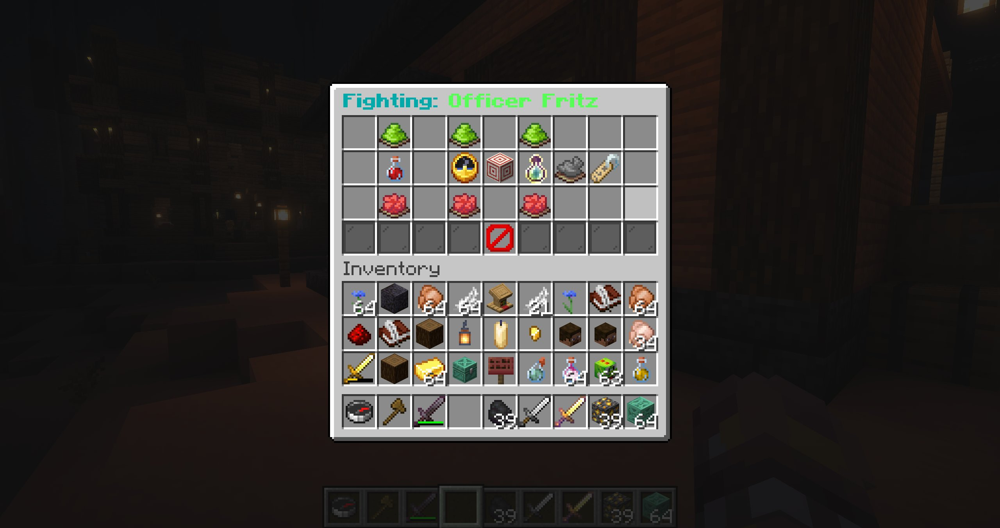
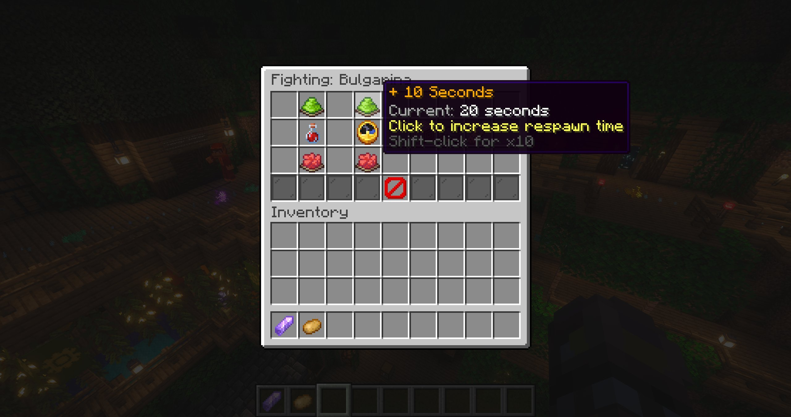

# Combat

Combat is configured per preset under **Fighting & Survival**.

  

## Health and respawning

- Maximum health ranges from `0` to `1024` and changes in steps of 5.
- A value of `0` makes the NPC invulnerable.
- Respawn time changes in 10-second steps. `0` disables respawning.
- A respawning NPC needs a preset spawnpoint.
- Dropped experience changes in steps of 5.
- The optional boss bar is visible to players within 16 blocks.
- A damaged NPC shows a small `[■■■■□□□□□□]` health bar above its head, visible within 16 blocks. It disappears once the NPC is back to full health. Turn it off or change the distance under `health-bars` in `config.yml`.
- Out of combat, damaged NPCs regenerate like players do. After 10 seconds without fighting or taking damage they heal back to full within 40 seconds, whatever their max HP. Tune or disable this under `health-regeneration` in `config.yml`. It does not trigger **On Heal**, which reacts to bursts such as potions.

Health, respawn time, and dropped experience each use one icon. **Left-click** decreases the value, **right-click** increases it, **shift-click** uses five steps, and **middle-click** lets you enter an exact whole number in chat. Setting health or respawn time to `0` keeps the behaviours described above.

Pending combat respawns survive server restarts and keep the persistent instance UUID.

## Aggression

| Mode | Behaviour |
| --- | --- |
| Ignore | Ignores attacks. |
| Fights Back | Retaliates against any eligible attacker. |
| Flee | Runs away when attacked. |
| Hunting | Attacks enabled target types on sight and retaliates against any eligible attacker. |

The **Hunt** toggles appear when **Hunting** is selected. The editor remembers them when you switch modes. With all four toggles off, Hunting only retaliates. Use **Abilities → Ability Targets** to control which bystanders abilities can hit.

An NPC with **Hold Pose** (NPC Properties) stays in its pose when hit: it fights only within its weapon's reach and never walks, flees, or dashes in combat. See [Holding a pose](customization.md#holding-a-pose).

The hunt categories are hostile mobs, animals, Survival and Adventure players, and other vulnerable Blockfolk NPCs. NPCs in **Fights Back** or **Hunting** can also retaliate against peaceful mobs such as iron golems.

An NPC under attack from several sides keeps its current opponent unless that opponent is gone, out of sight for a second, or a new attacker is more than three blocks closer. Every attacker is remembered for ten seconds: when the current opponent dies or escapes, the NPC turns to the closest remembered attacker instead of leaving combat.

## Abilities

Open **Fighting & Survival → Abilities** to assign attacks from the shared **Abilities** library and adjust how often the NPC uses them. The library provides editable spells, fire breath, a sonic beam, a defensive shockwave, and a short reposition blink. Build custom attacks with origins, shapes, instant or delayed casts, cooldowns, damage, combined effects, and particle themes.

See [Abilities](/features/abilities) for the attack editor, templates, and casting rules. Attacks require active combat and maximum health above zero. Each instance has independent cooldowns and mixes assigned attacks with its weapon combat. Existing assignments to the original eight special attacks remain valid.

**Change Fight Options** includes the same attack assignment screen, so behaviours, waypoint actions, and question branches can temporarily change the NPC's attacks and usage interval.

## Alliances

NPCs with the same non-empty alliance value do not fight each other, and neither do spawned copies of the same preset.
Alliance names ignore capitalization.

NPCs in **Fights Back** or **Hunting** join the fight when one of their allies is attacked within 16 blocks.
Damage between allies, such as a stray arrow, is cancelled. A player can appear allied to an NPC by carrying an item whose custom display name matches
that NPC's alliance. The comparison ignores capitalization and checks every inventory slot; allied NPCs will neither
choose that player as a target nor retaliate against them. Allied NPCs in **Fights Back** or **Hunting** within 16 blocks of that player also defend them, and their stray hits do not harm them.

## Runtime combat actions

**Start Combat** starts an encounter from a behaviour routine. **Change Fight Options** temporarily changes aggression, hunt targets, and ability settings without modifying the stored combat profile.

AI combat is separately gated by the preset's enabled AI capabilities. The response still passes validated nearby targets only.

If the main hand and off hand contain a melee weapon and a bow or crossbow, the NPC uses the bow beyond three blocks and switches to melee within three blocks. The equipped hands return to their configured order when combat ends.

## Loot and experience

Experience is dropped when a vulnerable NPC dies. Items come from the independently rolled loot slots configured in [Customization & equipment](/features/customization).
