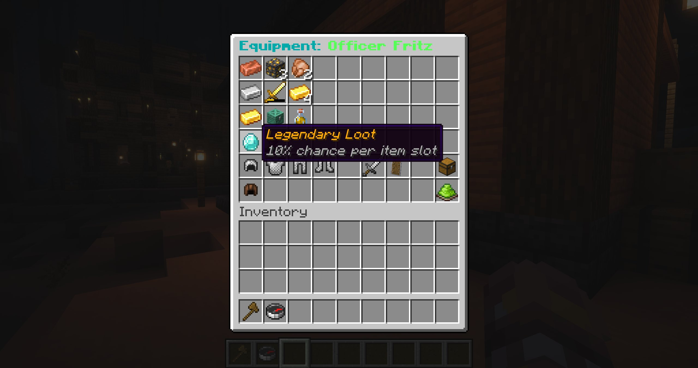

# Customization & equipment

## Appearance

The preset editor supports a display name and a skin URL or texture hash. Enter `default` when editing the skin to clear it. External image URLs are resolved through MineSkin; a MineSkin API key is optional but raises the public rate limit.

Click the NPC head in the preset editor to open **NPC Properties**, where you can configure:

| Property | Effect |
| --- | --- |
| Pushable | Allows players to move the NPC by colliding with it. |
| Show Name | Displays the name hologram above the NPC. |
| Look at Player | Turns toward the nearest player with a subtle body turn. |
| Item Pickup | Collects nearby item entities into that instance's temporary inventory. |
| Board Vehicles | Gets into an empty minecart or boat it walks or stands next to, including while following a route. Off by default. |
| Keep Chunks Loaded | Keeps the chunks around each instance loaded as it moves, so it keeps walking with no player nearby. Off by default. |
| Pose | Standing, Crouching, Sleeping, Sitting, Swimming / Crawling, or Fall Flying. |
| Name Color | The color used for the visible NPC name. |

On/off settings switch with a click; their icon, name color, and tooltip show the current state. Multi-option settings such as Pose and Name Color list every option in their tooltip with a `▶` marker on the current one: left-click selects the next option, right-click the previous one.

The selected pose is saved in the preset, applies to all its instances, and survives respawns and restarts. Sitting bends the legs using an invisible seat; changing poses or deleting the NPC removes that seat. Swimming / Crawling uses the same horizontal player pose, while Fall Flying supplies the elytra-style pose without initiating flight. These options cover all five native poses accepted by Paper's mannequin entity plus mounted sitting. Wave and Jump remain available under behavior **Animations**, which now also includes Sitting.

## Riding minecarts and boats

With **Board Vehicles** on, an NPC climbs into any empty minecart, boat, or raft it touches, whether it is standing idle or walking a route. Seated NPCs (Sitting pose) and NPCs in combat stay put. While riding, the NPC cannot walk: its route, Move To, and Follow wait until the ride ends. The vehicle moves only on powered rails, when pushed, or when a player paddles a boat the NPC shares.

Rides end through the world:

- an **activator rail** that is powered ejects the NPC as the cart passes over it;
- breaking the minecart or boat drops the NPC where it was;
- a server restart or plugin reload puts every NPC back on foot beside its vehicle;
- an AI NPC told to walk somewhere (Move To, Follow, Flee, Interact, Return Home, or Start Route) gets out first.

After getting out, a route restarts from the waypoint nearest the drop-off. The NPC waits three seconds before boarding again and never climbs back into the vehicle it just left while it is still within four blocks of it, so a cart stopped at an activator rail does not swallow it again.

With the setting off, minecarts and boats that bump into the NPC no longer scoop it up. AI NPCs can still get in or out on request through the **Enter/Exit Vehicle** capability (see [AI Behaviour](ai-behaviour.md)).

## Keeping chunks loaded

Normally an NPC stops when no player is close enough to keep its chunk loaded: it freezes where it stands and carries on once a player comes back. Turn on **Keep Chunks Loaded** for NPCs that walk long routes or travel far on their own. Each instance of the preset then holds the chunks around itself loaded, and the loaded area moves with it; chunks it leaves behind are released. Chunks ahead are loaded in the background, so a walking NPC does not stall the server.

The setting also keeps the NPC's pathfinding running when no player is within the server's entity activation range. Riding NPCs keep their surroundings loaded too.

How many chunks each NPC keeps loaded is set by `chunk-loading.radius` in `config.yml`: `0` is only its own chunk, `1` (the default) a 3×3 area, up to `3` for 7×7. Every loaded chunk costs server performance, so enable the setting only for presets that need it. Turning it off, deleting the NPC, or a pending respawn releases its chunks.

## Equipment & Loot

The **Equipment & Loot** editor stores helmet, chestplate, leggings, boots, main-hand item, and off-hand item. Select **Save Equipment & Loot** to persist the contents and refresh every spawned instance.

## Loot

The upper part of the equipment editor is a loot table. Every filled slot rolls independently when the NPC dies. Rows use these chances:

| Tier | Chance per filled slot |
| --- | ---: |
| Common | 100% |
| Uncommon | 50% |
| Rare | 25% |
| Legendary | 10% |

Loot is separate from the armor and held-item slots below it.

## Temporary inventory

Every instance can carry a temporary 27-slot inventory at runtime. Item pickup and several AI capabilities use it. Click the barrel in **Equipment & Loot** to pre-fill a preset's temporary inventory. New and respawned instances start with these items; existing active instances keep their current contents. Changes in this editor save when you leave it. The preset's **Temporary Inventory** AI option controls whether AI can perceive and manipulate those contents.
