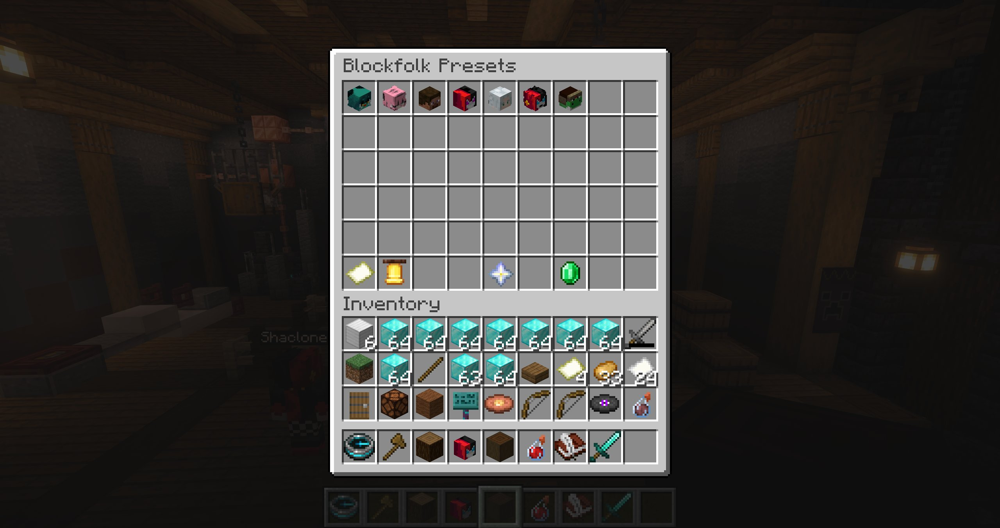

# NPCs & variants

NPC administration starts in the preset browser opened by `/bf`.

## Create and organize presets

Create a preset with `/bf create <name>` or from the browser. Its stable key is derived from the initial name; the visible display name can be changed later. The browser supports paging and duplicating presets.

The creation dialog sets the starting values: name, an optional skin (HTTPS image URL or Minecraft texture hash), HP and dropped XP (each up to 200 here; the editor allows more later), a basic combat reaction (**Ignore attacks**, **Fight back**, **Flee**, or **Hunt hostile mobs**), respawn time, and the pickup, name, look-at and push toggles.

To customize the preset order, click **Blockfolk Overview** at the bottom of the preset browser. In **Reorder NPC Presets**, pick up and drop preset icons into their desired positions, then choose **Save Order**. The saved order controls the main NPC browser and the NPC folders shown in the route manager.

Opening a preset gives access to:

- display name, skin, and preset spawnpoint;
- NPC properties and name color;
- equipment and loot;
- event behaviour;
- AI behaviour and combat;
- spawning and managing variants.

  
  

## Preset spawnpoint

Select **Preset Spawnpoint** to save your current position. The spawnpoint is used for the first spawn and for combat respawning. Configure it before enabling a non-zero combat respawn time.

## Variants

The preset is the main NPC. Each spawned copy of it is a **variant**. The first visible copy is created with **Spawn NPC**. After that, **Variants** in the editor lists every copy of the preset. **Spawn Here** adds another one at your position, identical to the preset.

A variant shares everything with its preset (display name, equipment, properties, behaviour, AI, combat, and memories) except what you set on it:

| Override | What it does |
| --- | --- |
| **Label** | A name only administrators see, such as "North Gate", shown in the variant list instead of "Variant 2". |
| **Skin** | Its own skin URL or texture hash. Shift-right-click the Skin button, or enter `inherit`, to use the preset's skin again. |
| **Spawn Point** | Where it stands after restarts and combat respawns. Every variant has its own. |
| **Routes** | Route swaps: whenever the preset's actions, a scene, or the AI make the NPC walk one of its routes, this variant walks another route of the same NPC instead. |

Shift-left-click a variant in the list to edit these. Each variant's tooltip shows which skin and routes it uses. In the list:

- left-click teleports to the variant;
- middle-click moves it and its spawn point to you;
- right-click removes it (asks first).

When a preset has exactly one variant:

- shift-left-click **Variants** to teleport to the NPC;
- middle-click it to move the NPC and its respawn location to you.

Combat respawns preserve the variant's UUID, its overrides, and its pending deadline across restarts.

### Route swaps

Route swaps let several variants share one routine while each walks its own path. For example, a guard preset's **On Spawn** runs **Set Route: Patrol**. Give the North Gate variant the swap *Patrol → Patrol North* and the South Gate variant *Patrol → Patrol South*. Both run the same routine, but each walks its own loop.

Open **Routes** in the variant editor to see the preset's routes. Click one to pick its replacement, or use **Create Route** to make a new one and swap it in right away. Replacement routes belong to the same NPC, so they appear in its Routes menu as usual and can have their own waypoint actions. The AI keeps using the preset's route names, and the swap is applied when the variant starts walking. Deleting a route removes any swap from or to it, and the variant falls back to the preset's route.

::: tip When to use a separate preset
Use a variant when only the look, the spot, or the path differs. If an NPC needs its own name, dialog, equipment, or AI personality, make a separate preset (for example by duplicating it).
:::

## Direct editing

An administrator with `blockfolk.admin` can hold Shift and right-click a spawned Blockfolk NPC to open its preset editor directly. This admin shortcut takes priority over the NPC's normal **On Right-Click** behaviour and BeautyQuests interaction.

## Edit and delete

Click the NPC head in its editor to open NPC properties. Shift-right-click the head to begin deletion. Preset changes are persisted automatically; equipment and loot have an explicit **Save Equipment & Loot** control.

::: warning Integration references
An integration such as BeautyQuests targets a spawned variant, not merely the preset. Removing that variant breaks the external reference even if another copy of the same preset exists.
:::
