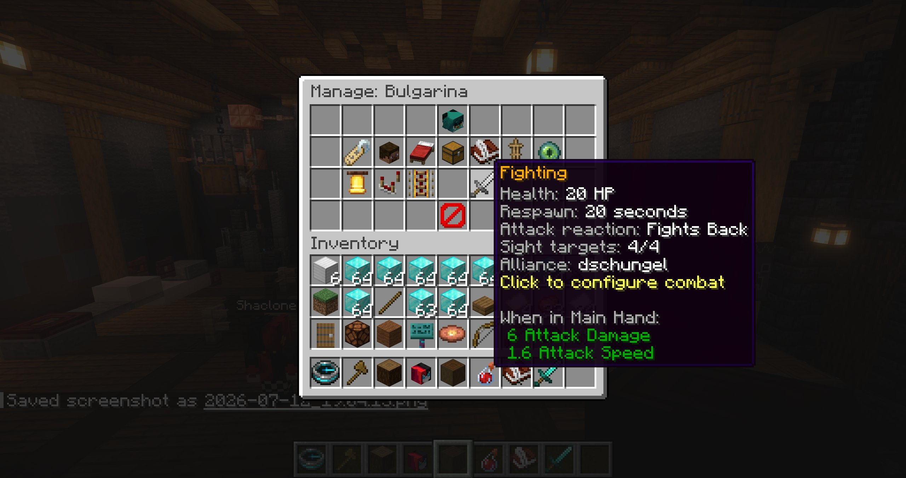

# NPCs & variants

NPC administration starts in the preset browser opened by `/bf`.

## Create and organize presets

Create a preset with `/bf create <name>` or from the browser. Commands refer to a preset by its current name, and names must be unique. Behind the scenes each preset also keeps a stable key from the name it was created with, so routes, scenes, and quests stay linked after a rename. Duplicate a preset with `/bf npc <name> duplicate <new name>`. The browser supports paging.

The creation dialog sets the starting values: name, an optional skin (HTTPS image URL or Minecraft texture hash), HP and dropped XP (each up to 200 here; the editor allows more later), a basic combat reaction (**Ignore attacks**, **Fight back**, **Flee**, or **Hunt hostile mobs**), respawn time, and the pickup, name, look-at and push toggles.

To customize the preset order, click **Blockfolk Overview** at the bottom of the preset browser. In **Reorder NPC Presets**, pick up and drop preset icons into their desired positions, then choose **Save Order**. The saved order controls the main NPC browser and the NPC folders shown in the route manager.

Opening a preset gives access to:

- display name, skin, and preset spawnpoint;
- NPC properties and name color;
- equipment and loot;
- event behaviour;
- AI behaviour and combat;
- spawning and managing variants.

  
  

## Preset spawnpoint

Select **Preset Spawnpoint** to save your current position. The spawnpoint is used for the first spawn and for combat respawning. Configure it before enabling a non-zero combat respawn time.

## Variants

The preset is the main NPC. Each spawned copy of it is a **variant**. The first visible copy is created with **Spawn NPC**. After that, **Variants** in the editor lists every copy of the preset. **Spawn Here** adds another one at your position, identical to the preset.

A variant is the same character in another place. It shares its identity with the preset (display name, equipment, properties, AI, combat, and long-term memories) and can differ in what you set on it:

| Override | What it does |
| --- | --- |
| **Label** | A name only administrators see, such as "North Gate", shown in the variant list instead of "Variant 2". |
| **Skin** | Its own skin URL or texture hash. Shift-right-click the Skin button, or enter `inherit`, to use the preset's skin again. |
| **Spawn Point** | Where it stands after restarts and combat respawns. Every variant has its own. |
| **Routes** | Route swaps: whenever the preset's actions, a scene, or the AI make the NPC walk one of its routes, this variant walks another route of the same NPC instead. |
| **Behaviour** | Its own actions for chosen events, such as a different **On Right-Click** in the village than in the jungle. Events it does not override keep running the preset's actions. |

Each variant's tooltip shows which skin, routes, and behaviour it uses.

- Left-click opens the variant editor.
- Right-click teleports you to the variant.
- Middle-click moves the variant and its spawn point to you.
- Shift-right-click asks you to confirm removal.

When a preset has exactly one variant:

- shift-left-click **Variants** to teleport to the NPC;
- middle-click it to move the NPC and its respawn location to you.

Combat respawns preserve the variant's UUID, its overrides, and its pending deadline across restarts.

### Route swaps

Route swaps let several variants share one routine while each walks its own path. For example, a guard preset's **On Spawn** runs **Set Route: Patrol**. Give the North Gate variant the swap *Patrol → Patrol North* and the South Gate variant *Patrol → Patrol South*. Both run the same routine, but each walks its own loop.

Open **Routes** in the variant editor to see the preset's routes. Click one to pick its replacement, or use **Create Route** to make a new one and swap it in right away. Replacement routes belong to the same NPC, so they appear in its Routes menu as usual and can have their own waypoint actions. The AI keeps using the preset's route names, and the swap is applied when the variant starts walking. Deleting a route removes any swap from or to it, and the variant falls back to the preset's route.

### Variant behaviour

Open **Behaviour** in the variant editor to see the same event rows as the preset's behaviour editor. Each row shows **From preset** until the variant gets its own actions for that event:

- left-click a row's header to give the variant its own row, starting as a copy of the preset's;
- or simply edit, add, or remove an action: the row becomes the variant's own first;
- right-click the header of an own row (it glints) to use the preset's actions again.

An own row replaces the preset's row for that event completely; it is not merged with it. An own row with no actions makes the variant do nothing on that event, for example no shop on right-click in one place. Later changes to the preset's row do not reach an own row. Scene reactions still take priority while the variant plays a scene role.

Short-term memory (recent events and conversations) belongs to each variant, while long-term memories are the preset's and shared. A player who talked to the jungle variant meets the village variant fresh, but it remembers whatever was consolidated into long-term memory.

### Detach as new NPC

When a variant has drifted far enough to be its own character, click **Detach as New NPC** in the variant editor and enter a name. Blockfolk creates a new preset copied from the original, with the variant's skin, spawn point, and own behaviour rows built in. The original's routes are copied for the new NPC, with the variant's route swaps baked in. The new NPC spawns where the variant stands, and the variant is removed.

The new NPC starts with the long-term memories the preset has at that moment but no longer shares new ones. Scene roles, quests, and integrations that target the original preset or the variant's UUID do not carry over. The variant's world must be loaded to detach it.

::: tip When to use a separate preset
Use a variant when the same character should appear in another place, with a different look, spot, path, or reactions there. If an NPC needs its own name, equipment, or AI personality, make a separate preset by duplicating it or detaching a variant.
:::

## Direct editing

An administrator with `blockfolk.admin` can hold Shift and right-click a spawned Blockfolk NPC to open its preset editor directly. This admin shortcut takes priority over the NPC's normal **On Right-Click** behaviour and BeautyQuests interaction.

## Edit and delete

Click the NPC head in its editor to open NPC properties. Shift-right-click the head to begin deletion. Preset changes are persisted automatically; equipment and loot have an explicit **Save Equipment & Loot** control.

::: warning Integration references
An integration such as BeautyQuests targets a spawned variant, not merely the preset. Removing that variant breaks the external reference even if another copy of the same preset exists.
:::
